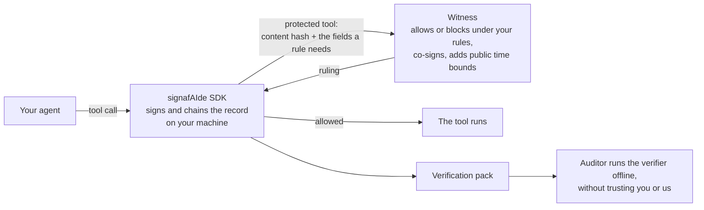

# signafAIde SDK

[](https://github.com/AIME-TECH-UK-LIMITED/signafaide-sdk/actions/workflows/ci.yml) [](https://www.npmjs.com/package/signafaide) [](https://pypi.org/project/signafaide/) [](LICENSE) [](https://scorecard.dev/viewer/?uri=github.com/AIME-TECH-UK-LIMITED/signafaide-sdk) [](https://glama.ai/mcp/servers/AIME-TECH-UK-LIMITED/signafaide-sdk)

signafAIde checks each risky AI agent tool call before it runs, and proves what your agents did.


<sub>A real run of [`examples/payout-agent`](examples/payout-agent) against a free sandbox (the claim link is masked).</sub>

- **Record:** every tool call is signed with the agent's own key and chained on the machine that made it.
- **Protect:** an independent witness allows or blocks risky calls (pay, delete, send, run a command, push code) under your published rules; protect a tool with `npx signafaide protect` or one click in the console.
- **Prove:** share a link your auditor checks offline, without trusting you or us ([for auditors](#for-auditors)).

- **Free on its own:** the SDK and the verifiers are Apache-2.0 and need no account. On their own they give you a signed, chained, offline-verifiable record of every tool call, on your machine. The service adds what one party cannot give itself: an independent second signature, two public time bounds, and a check that no record is missing.
- **Local first:** with no API key, records are signed, chained and verified in `.signafaide/`, and nothing is sent. Blocking a call needs the witness to allow it, so a protected tool runs only with a key or a free sandbox; recording does not. Sending starts only when a person runs `signafaide init` (a sandbox: no account, email or card) or sets `SIGNAFAIDE_API_KEY`.
- **Hashes, not content:** after the opt-in, each record sends its content hash with its tool name, agent name and time (and its chain links), never its inputs or outputs, unless you turn on stored content. Tool and agent names are sent as you write them, so don't put personal data in them. Each content hash is salted with 16 random bytes that stay on your machine with the content, so the hash alone cannot be used to guess the content, even when it has only a few possible values.
- **Your environment:** the default witness is the hosted service (`https://api.signafaide.co.uk`). A self-hosted witness, under an Enterprise contract, is set with `SIGNAFAIDE_URL` ([self-host guide](https://signafaide.co.uk/docs/self-host)). Running in production: [production guide](https://signafaide.co.uk/docs/production).
- **Independent checks:** the protocol is a public spec with test vectors, and the verifier checks a verification pack without our service.

## How it works



## What is here

| path | what |
|---|---|
| [`spec/SPEC.md`](spec/SPEC.md) | the protocol: records, batches, receipts, anchors, the HTTP API, verification packs, local state |
| [`spec/vectors.json`](spec/vectors.json) | test vectors every implementation reproduces byte for byte |
| [`python/`](python/README.md) | the Python SDK and CLI (`signafaide` on PyPI) |
| [`python-langchain/`](python-langchain/README.md) | `langchain-signafaide`: a LangChain agent middleware that records every tool call the agent makes |
| [`js/`](js/README.md) | the TypeScript SDK, CLI and `agent setup` for coding agents (`signafaide` on npm), and the MCP server (`signafaide-mcp`, in `js/mcp`) |
| [`CHANGELOG.md`](CHANGELOG.md) | what changed in each release; every release is a git tag (`v0.5.9`) |
| [`verifier/`](verifier/README.md) | `signafaide-verify`, the standalone Rust verifier of a pack (also builds to WebAssembly); its PyPI package (`verifier/pyproject.toml`) and the release binaries |
| [`js/verify/`](js/verify/package.json) | `signafaide-verify` on npm: the TypeScript verifier as one file, for auditors |
| [`core/`](core) | the Rust protocol core shared by the verifier and the service |
| [`plugin/`](plugin/README.md) | the Claude Code plugin: the MCP server and the skill |

## Quick start

In your agent's folder, at a terminal:

```bash
npx signafaide protect            # TypeScript or JavaScript
uv run signafaide protect         # Python (after uv add signafaide; or .venv/bin/signafaide protect)
```

`protect` finds the agent's tools, asks which to protect and what to block (On or Calibrating), shows the code change and asks before writing it, makes a free sandbox if you say yes and saves your rules. Then:

```bash
npx signafaide check approve_payout amount=1200 currency=GBP   # a dry run: exit 1 when it would block
npx signafaide status                                            # one line per tool: recorded, protected, proof
npx signafaide prove approve_payout                              # a read-only link for your auditor
```

One agent name = one key: each machine, replica or CI job that runs the agent needs its own agent name, or the same agent key (see the [production guide](https://signafaide.co.uk/docs/production)). `status` and `prove` say when they don't match.

To wrap a tool in code instead (this is what `protect` writes):

```python
import signafaide

@signafaide.protect(agent="payout-bot")   # asks the witness before it runs
def approve_payout(payee: str, amount: float, currency: str): ...
```

```ts
import { protect } from "signafaide";

export const tools = {
  approve_payout: protect(approve_payout, { args: ["payee", "amount", "currency"], agent: "payout-bot" }),
};
```

`pull` fetches the rules saved in the console, `login` signs a person in to save rules after the sandbox is kept. A runnable example: [`examples/payout-agent`](examples/payout-agent); starters with a protected tool in place: [`templates/`](templates). To wrap tools by hand, see the reference sections of the [Python](python/README.md) and [TypeScript](js/README.md) READMEs.

- **Protected in code is protected.** A tool wrapped with `protect()` (or `@signafaide.protect`) runs every check on this machine On even without `signafaide.checks.json`, asks signafAIde for a ruling, and counts as protected in `status`, `prove`, `verify`, `check --ci` and the console.
- **Without a terminal** (a coding agent, a script, CI), `protect --yes` protects every tool that pays, deletes, sends messages, runs commands, pushes code or edits secrets or config, and gives each a default rule that starts Calibrating (it blocks nothing until a person turns it On): above 1,000 for a tool that pays and has an amount, else a number of calls a minute. The rules are saved in a sandbox nobody has kept yet, kept in `signafaide.checks.json` with no key, or, on a project an API key cannot save rules in, kept there with one console link per tool where a person adds the rule with one click. A field a rule needs is sent only after a person approves it with `signafaide pull` at a terminal. Details: [TypeScript](js/README.md#without-a-terminal-protect---yes), [Python](python/README.md#without-a-terminal-protect---yes).
- **Tests.** Under pytest, Vitest, Jest and `node --test` a protected tool runs without a ruling and nothing is sent; never with a live key.
- **Networks that block the witness.** When a proxy or network policy refuses it, the SDK says so in one sentence: allow `signafaide.co.uk` and `api.signafaide.co.uk` in the environment's network settings. Both SDKs go through `HTTPS_PROXY`, `HTTP_PROXY` and `NO_PROXY` (TypeScript also `ALL_PROXY`).

## Add the MCP server to a coding agent

The MCP server (`signafaide-mcp`, Node.js 20 or later) lets a coding agent preview the setup, verify records and show status. It sends nothing until a person agrees to create a sandbox. In a project, `npx signafaide agent setup` writes this for each coding agent it finds. To add it by hand, put this in the agent's MCP configuration (Cline, Cursor, Windsurf, Kiro, Zed and others use the same shape):

```json
{
  "mcpServers": {
    "signafaide": { "command": "npx", "args": ["-y", "signafaide-mcp@0.5.9"] }
  }
}
```

- Claude Code: `claude mcp add signafaide -- npx -y signafaide-mcp@0.5.9`
- Gemini CLI: `gemini extensions install https://github.com/AIME-TECH-UK-LIMITED/signafaide-sdk`
- Kiro: [](https://kiro.dev/launch/mcp/add?name=signafaide&config=%7B%22command%22%3A%22npx%22%2C%22args%22%3A%5B%22-y%22%2C%22signafaide-mcp%400.5.9%22%5D%2C%22disabled%22%3Afalse%2C%22autoApprove%22%3A%5B%5D%7D)

There are no API keys or other settings. To check it works, ask the agent to call `signafaide_status`.

## Recording everything an agent can call

Wrapping records the tools a developer wraps. Three things cover the rest.

- MCP tools: `signafaide gateway -- <the MCP server's command>` (in the `signafaide` npm package) runs an MCP server behind a recording proxy. The agent's MCP client starts the gateway in place of the server, for example `npx -y signafaide gateway --agent support-bot -- npx -y @modelcontextprotocol/server-filesystem /data`. Every tool call that passes through is recorded, a decision before the call is forwarded and an outcome when the answer arrives, and a call that cannot be recorded is not forwarded. A remote (HTTP) server goes behind a stdio bridge: `npx -y signafaide gateway -- npx -y mcp-remote https://mcp.example.com/mcp`.
- Traced agents: an agent already traced with OpenTelemetry is recorded with no wrapping, by one span processor added where tracing is set up (`SignafaideSpanProcessor`, in `signafaide.otel` for Python and `signafaide/otel` for TypeScript). It reads tool-call spans by the OpenTelemetry GenAI, OpenInference and OpenLLMetry conventions and exports nothing. Each record says that it comes from telemetry and whether its decision was written before the tool ran or after it, and what the tracing sampler can leave out is reported as a note. Running a tool only once it is recorded (a protected tool) needs the SDK's wrappers. See the [Python](python/README.md#opentelemetry-records-from-the-traces-you-already-have) and [TypeScript](js/README.md#opentelemetry-records-from-the-traces-you-already-have) READMEs.
- Framework tools: `wrap_tools` / `wrapTools` declare the tools they wrap as recorded, and `declare_tools([...])` / `declareTools([...])` takes the agent's full tool list, so the tools that are not wrapped are declared as not recorded. The declaration is a signed note per tool in the agent's chain (ordinary records, counted like any other), and every verifier reports it per agent, for example `all 4 declared tools are recorded` or `1 declared tool is not recorded: web_search`. It is a note, never a failure.

What this shows, and what it does not: the gateway records every call that goes through it; a call the application makes around it is still not recorded, so the deployment has to make the gateway the only route to those tools. A declaration is the program's own signed statement of its tools: evidence of what it said it had, not proof that the list is complete. A tool list is as fresh as its last declaration: a source that stops (a gateway that is removed, a program that ends) leaves the list at its clean exit, or within 24 hours after a crash. Details: [TypeScript](js/README.md), [Python](python/README.md), spec §2.6, §7 and §8.

## For auditors

`signafaide-verify` checks a verification pack on your own machine, without an account, the SDK or our console. It runs the 12 checks of spec §7 and ends with one result line. There are three ways to get it, each pinned to a release (the commands below name this one; use the version the customer's `signafaide prove` prints):

```bash
npx signafaide-verify@0.5.9 pack.json --agent-keys agent-keys.json --head head.json   # npm, Node.js 20 or later
uvx signafaide-verify@0.5.9 pack.json --agent-keys agent-keys.json --head head.json   # PyPI (or: pipx install signafaide-verify==0.5.9)
```

Or download the single program for Linux (static), macOS or Windows from [GitHub Releases](https://github.com/AIME-TECH-UK-LIMITED/signafaide-sdk/releases), with `SHA256SUMS` from the same release, and check both the checksum and how it was built (by `release.yml` on `main`) before you run it. `LICENSE` and `THIRD-PARTY-NOTICES.md` (the licences of the Rust crates in it) are in the same release, and in every wheel and the sdist:

```bash
sha256sum --check --ignore-missing SHA256SUMS
gh attestation verify signafaide-verify-linux-x86_64 \
  --repo AIME-TECH-UK-LIMITED/signafaide-sdk \
  --signer-workflow AIME-TECH-UK-LIMITED/signafaide-sdk/.github/workflows/release.yml \
  --source-ref refs/heads/main
chmod +x signafaide-verify-linux-x86_64
```

On macOS use `shasum -a 256 --check --ignore-missing SHA256SUMS`; on Windows compare `Get-FileHash signafaide-verify-windows-x86_64.exe` with its line in `SHA256SUMS`. The files are `signafaide-verify-linux-x86_64`, `-linux-arm64`, `-macos-x86_64`, `-macos-arm64` and `-windows-x86_64.exe`. The macOS programs are not notarised by Apple yet, so macOS may refuse to open them: on a Mac, use the npm or PyPI package above instead.

What each one is: the PyPI wheels hold these same release binaries, file for file; on a platform without a wheel, pip builds the Rust verifier from the sdist, which needs a Rust toolchain. The npm package is a different implementation, the TypeScript verifier, in one file with no dependencies. All of them, and the SDKs' `signafaide verify`, give the same check ids, statuses and result line for the same inputs (spec §7); CI runs the spec vectors and the same input cases through each.

**The service keys.** Each release of `signafaide-verify` has the hosted witness's public keys pinned in it, and verifies with those. Online, it also reads the list published at `https://signafaide.co.uk/.well-known/signafaide-keys.json`: keys are never removed or changed, so every pinned key must be there with the same bytes. A key retired there (it has a `valid_to`) is applied, so records it signed later fail. A key revoked there (listed under `revoked`) is applied too: nothing it signed verifies. Both are named on the `service keys:` line and the run goes on. Newer keys in the list (after a rotation) and fields this release does not know are fine; a pack made since a newer key became valid needs a newer `signafaide-verify`, and the output names those keys. If a pinned key is missing or changed there, or its `revoked` list is malformed, it stops with `KEYS DIFFER` and exit code 2 and verifies nothing. If the list cannot be read (no network, an error, a redirect), it verifies with the pinned keys and says so above the result line: `service keys: pinned in signafaide-verify 0.5.9, not cross-checked (published list unreachable)`; the public timestamp is still looked up. With `--offline` nothing is looked up and the line says `not cross-checked (--offline)`. `--keys <file|url>` uses other keys, for example a self-hosted witness's own list, read the same way (a key that document lists as revoked verifies nothing), and unless it is exactly the pinned set (every entry the same, including `valid_from` and `valid_to`, and nothing revoked) the result line itself says so: `PASS (service keys from --keys differ from the pinned set): ...`. The line above the result always says where the keys came from, and `--json` has `service_keys_source`, `service_keys_cross_check` and `service_keys_pinned_set`. The agent keys, `agent-keys.json`, come from the customer (`signafaide keys export`), and `head.json` (their newest signed head) shows that no record was cut from the end.

`--offline` makes no network request at all: the public timestamp check is then reported as not checked, never as passed. `--json` prints the report for other tools. Redirects are never followed. Behind a TLS-inspecting proxy, point `SSL_CERT_FILE` (binary and PyPI) or `NODE_EXTRA_CA_CERTS` (npm) at its CA certificates; the verifier says so on stderr.

The last line is the result, for example `PASS: 12 of 12 checks passed; export of every agent, all records, generated 2026-11-20T09:00:00.000Z`. Exit code 0 is PASS, 1 is FAIL, 2 means an input could not be read or the keys differ. Only checks that passed are counted as passed: a public timestamp that has not confirmed yet is pending (usually a few hours), for example `PASS: 11 of 12 checks passed, 1 pending (public timestamp)`, and a check that could not run is not checked. When the keys did not come from an independent source, the result says so in brackets after PASS.

To build the verifier from source: `cargo run --release --manifest-path verifier/Cargo.toml -- pack.json --agent-keys agent-keys.json`.

A pack that passes shows what the agent's program recorded and that it was not changed later; it does not show that the content was true, or a call that was never recorded. The full list: [Limits of a signafAIde record](https://signafaide.co.uk/docs/limits).

## For security scanners and reviewers

Automated scanners flag this package because it reads credentials from the environment and talks to a network host. Both are expected for a client of a remote witness. This is what it does:

- **Credentials:** it reads `SIGNAFAIDE_API_KEY` (or the key `signafaide login` and `init` save in your user config folder) and sends it only to the witness, as the bearer token. It reads no other service's credentials. The checks look at tool arguments and results for secrets to block them; they never send them anywhere.
- **Other settings:** `SIGNAFAIDE_URL` (a self-hosted witness), `SIGNAFAIDE_HOME`, `SIGNAFAIDE_CHECKS` and a few more `SIGNAFAIDE_*` options listed in the SDK READMEs, and the standard proxy and CA variables (`HTTPS_PROXY`, `HTTP_PROXY`, `ALL_PROXY`, `NO_PROXY`, `NODE_EXTRA_CA_CERTS`, `SSL_CERT_FILE`).
- **Hosts, before any opt-in:** none. With no API key, records are signed and kept in `.signafaide/` on your machine.
- **Hosts, after `signafaide init` or an API key:** the witness (`https://api.signafaide.co.uk`, or your `SIGNAFAIDE_URL`), and `https://signafaide.co.uk/.well-known/signafaide-keys.json` for the published service keys.
- **Hosts when verifying:** a public block explorer API (`https://mempool.space/api` by default, or the one you pass) to confirm public timestamps, and the published key list. `--offline` makes no request at all.
- **No install scripts:** the npm packages have no install or postinstall scripts, and the release workflow publishes with `--ignore-scripts`.
- **What leaves your machine:** a salted content hash, the tool and agent names, the time and the chain links, plus only the argument fields a rule lists under `disclose`. See "Hashes, not content" above and the [privacy notice](https://signafaide.co.uk/legal/privacy).

## Privacy and support

- Privacy: [privacy notice](https://signafaide.co.uk/legal/privacy)
- Support: [open an issue](https://github.com/AIME-TECH-UK-LIMITED/signafaide-sdk/issues) or email sales@signafaide.co.uk
- Security reports: see the [security page](https://signafaide.co.uk/security)

## License

Apache-2.0, see [LICENSE](LICENSE).

## Contributing and security

See [CONTRIBUTING.md](CONTRIBUTING.md) for the layout and how to run the checks. Report vulnerabilities privately as described in [SECURITY.md](SECURITY.md).
